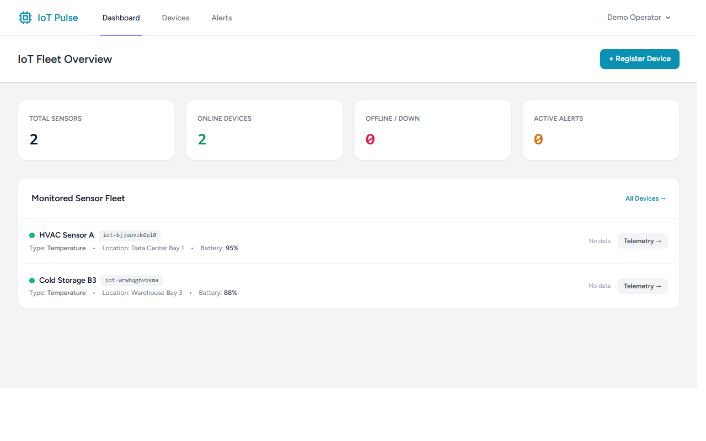
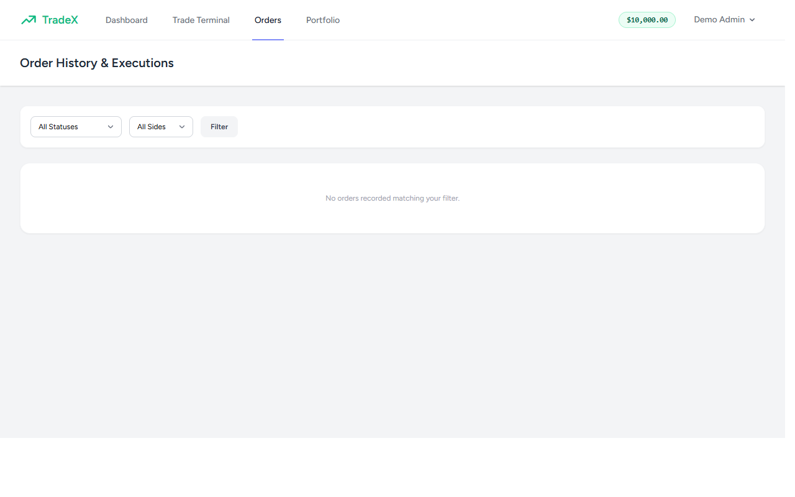

# WONDR — Indonesian Digital Goods & Game Top-Up Platform

Platform e-commerce top-up game dan voucher digital Indonesia yang cepat, aman, dan beroperasi 24/7. Dibangun menggunakan arsitektur monolit modern **Laravel 13 + React + Inertia.js + Tailwind CSS** dengan dukungan database **PostgreSQL/SQLite** dan **Redis**.

---

## 1. Arsitektur Inti & Alur Transaksi

```
[ Pelanggan ] 
      │ 
      ▼ (Pilih Game & Nominal, Input Player ID)
[ WONDR Catalog & Checkout ] 
      │ 
      ▼ (Server-Side Price Calculation & Unik Order Ref)
[ Inisiasi Pembayaran ] ──► [ Midtrans / Xendit / Sandbox ]
      │                               │ (Customer Pays)
      │                               ▼
[ Webhook Payment Event ] ◄── [ Callback Berlisensi ]
      │
      ▼ (Verifikasi Signature & Idempotency Check)
[ Status: Terbayar (PAID) ]
      │
      ▼ (Trigger Asynchronous Fulfillment)
[ Supplier Adapter ] ──► [ Digiflazz / Supplier Resmi API ]
      │
      ├── (Sukses) ──► [ Simpan SN / Serial ──► Status: COMPLETED ]
      └── (Timeout/Uncertain) ──► [ Flag UNCERTAIN / Manual Review ]
                                         │
                                         ▼ (Inquiry Status via Cron/Admin)
                                    [ Rekonsiliasi Otomatis ]
```

---

## 2. Fitur Utama

- **Katalog Game Lengkap**: Mobile Legends, Free Fire, PUBG Mobile, Genshin Impact, Valorant dengan form input ID/Server adaptif.
- **Kalkulasi Harga Server-Side**: Mencegah manipulasi harga dari sisi client, mendukung biaya layanan per metode pembayaran (QRIS, VA, E-Wallet).
- **Payment Gateway Adapter**: Mendukung Midtrans Snap & Sandbox simulator dengan verifikasi signature HMAC SHA-512 dan idempotency lock.
- **Supplier Fulfillment Adapter**: Integrasi Digiflazz dengan hashing MD5 `username + apiKey + ref_id`. Proteksi terhadap kegagalan jaringan (tidak melakukan double top-up saat timeout).
- **Pelacakan Pesanan Realtime**: Halaman tanda terima publik berbasis public reference acak (`WNDR-YYYYMMDD-XXXXXX`) dengan penyensoran ID akun.
- **Admin Dashboard & Rekonsiliasi**: Metrik pesanan, omset, margin keuntungan kotor, tabel pesanan, aksi rekonsiliasi transaksi menggantung, serta update harga jual produk.

---

## 3. Menjalankan Aplikasi Secara Lokal

### Prasyarat
- PHP 8.3+ (ekstensi `pdo_sqlite`, `pdo_pgsql`, `redis`)
- Composer 2+
- Node.js 20+ & npm

### Langkah Cepat (Development)
```bash
# 1. Masuk ke direktori
cd C:/Users/wondr/HermesWorkspace/wondr

# 2. Setup environment
cp .env.example .env
php artisan key:generate

# 3. Jalankan migrasi & data katalog
php artisan migrate:fresh --seed

# 4. Build asset frontend (React + Tailwind + Vite)
npm run build

# 5. Jalankan server lokal
php artisan serve
```

Aplikasi dapat diakses di `http://localhost:8000`.

---

## 4. Akun Default Pengujian

- **Admin Console**: `admin@wondr.id` / `AdminWondr2026!` (Akses menu `/admin/dashboard`)
- **Customer**: `gamer@wondr.id` / `GamerWondr2026!`

---

## 5. Pengujian Otomatis

Jalankan suite pengujian komprehensif (34 tests mencakup flow order, idempotency webhook, signature verification, timeout handling, and admin authorization):

```bash
php artisan test
```

---

## 6. Docker & Containerized Deployment

File `compose.yaml` sudah disiapkan untuk menjalankan stack produksi:
- `app`: PHP 8.3-FPM
- `web`: Nginx
- `postgres`: PostgreSQL 16
- `redis`: Redis cache & queue worker
- `queue`: Laravel queue worker

```bash
docker compose up -d --build
```


## Screenshots

### Dashboard Overview


### Login Overview


### Orders Overview

